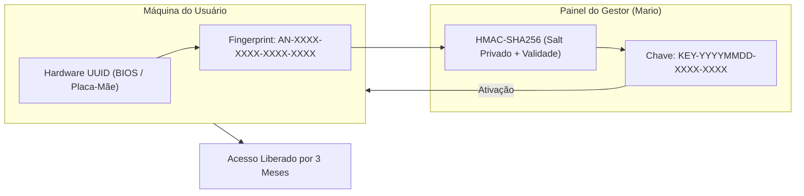

# 🧭 ArquivoNorte — Guia do Gestor: Licenciamento, Autenticação e Operação

> **Versão:** 2.0  
> **Gestor / Product Owner:** Mario Henrique  
> **Squad:** A-Team  
> **Data:** Novembro de 2026  

---

## 📑 Sumário
1. [Visão Geral da Solução](#-visão-geral-da-solução)
2. [Arquitetura de Segurança (Node-Lock)](#-arquitetura-de-segurança-node-lock)
3. [Passo a Passo da Ativação de Usuários](#-passo-a-passo-da-ativação-de-usuários)
   - [3.1 Na máquina do Novo Usuário](#31-na-máquina-do-novo-usuário)
   - [3.2 No Painel do Gestor (Mario Henrique)](#32-no-painel-do-gestor-mario-henrique)
   - [3.3 Conclusão da Ativação pelo Usuário](#33-conclusão-da-ativação-pelo-usuário)
4. [Painel de Administração (`Gerador-Licencas.bat`)](#-painel-de-administração-gerador-licencasbat)
5. [Armazenamento e Isolamento de Licenças](#-armazenamento-e-isolamento-de-licenças)
6. [Políticas de Expiração e Renovação](#-políticas-de-expiração-e-renovação)
7. [Perguntas Frequentes & Respostas de Segurança (FAQ)](#-perguntas-frequentes--respostas-de-segurança-faq)
8. [Estrutura de Arquivos do Projeto](#-estrutura-de-arquivos-do-projeto)

---

## 🎯 Visão Geral da Solução

O **ArquivoNorte** (*Busca inteligente de arquivos na sua rede*) é uma ferramenta corporativa de alta performance para localização instantânea de documentos e pastas em discos compartilhados de rede (como `H:\#Assessoria CCC 2026`, `H:\Assessoria CCC - 2025`, etc.).

Para impedir a cópia não autorizada, vazamento ou replicação descontrolada da ferramenta para terceiros ou máquinas não autorizadas, foi implementada uma camada de **licenciamento criptográfico Node-Lock de periodicidade controlada (padrão de 3 meses)**, sem dependência de internet ou servidores externos.

---

## 🛡️ Arquitetura de Segurança (Node-Lock)

O sistema de proteção opera com base em **dois pilares criptográficos**:



1. **Fingerprint de Hardware (Machine ID):**  
   Ao ser executado em uma máquina, o sistema lê o identificador único da placa-mãe/BIOS (`UUID`) via WMI e gera um código de 16 caracteres hexadecimais:
   $$\text{Formato: } \mathbf{AN\text{-}XXXX\text{-}XXXX\text{-}XXXX\text{-}XXXX}$$

2. **Chave Criptográfica HMAC-SHA256:**  
   O Gestor possui um gerador privado que combina o `ID da Máquina` com a `Data de Expiração` e assina com um **segredo mestre interno**.
   $$\text{Formato: } \mathbf{KEY\text{-}YYYYMMDD\text{-}XXXX\text{-}XXXX}$$
   *Ninguém consegue forjar uma chave válida sem o segredo do gestor, e uma chave gerada para uma máquina **nunca funcionará em outro computador**.*

---

## 🚀 Passo a Passo da Ativação de Usuários

### 3.1 Na máquina do Novo Usuário
1. O usuário dá duplo clique no executável [`ArquivoNorte.exe`](file:///g:/Meu%20Drive/Dev's/Docs%20CCC/ArquivoNorte.exe).
2. O sistema verifica se existe uma licença válida no perfil dele. Se não encontrar, abre automaticamente a janela:  
   **"🔒 Ativação de Licença Corporativa"**.
3. O usuário verá o campo com o código da máquina dele:
   - Exemplo: `AN-A7F2-94C1-D8E2-110F`
4. Ele clica em **`📋 Copiar ID`** e envia esse código para você (via WhatsApp, Teams ou Email).

---

### 3.2 No Painel do Gestor (Mario Henrique)
1. Você dá duplo clique no arquivo [`Gerador-Licencas.bat`](file:///g:/Meu%20Drive/Dev's/Docs%20CCC/Gerador-Licencas.bat).
2. O painel oficial do gestor abrirá na tela:
   - Clique no botão **`📋 Colar`** (o ID enviado pelo usuário será preenchido automaticamente).
   - O campo **Período de Validade** já vem pré-selecionado como **`3 Meses (Padrão Recomendado)`** *(você também pode escolher 6 meses, 1 ano ou 30 dias de teste)*.
   - Clique em **`⚡ GERAR CHAVE`**.
3. A chave é calculada e **copiada automaticamente para a sua Área de Transferência**.
4. Você pode clicar em **`💬 Copiar Mensagem WhatsApp`** para copiar uma mensagem formatada:
   ```text
   Olá! Sua licença do ArquivoNorte foi liberada.

   📅 Validade: até 18/02/2027 (3 meses)
   💻 ID Vinculado: AN-A7F2-94C1-D8E2-110F
   🔑 Chave de Ativação: KEY-20270218-E4A1-88C9

   Para ativar, abra o ArquivoNorte, cole a chave acima e clique em 'Ativar Aplicação'.
   ```
5. Envie a mensagem ou apenas a chave para o usuário.

---

### 3.3 Conclusão da Ativação pelo Usuário
1. O usuário cola a chave no campo **"INSIRA SUA CHAVE DE ATIVAÇÃO"** na tela do ArquivoNorte.
2. Ele clica em **`🚀 Ativar Aplicação`**.
3. O sistema valida a assinatura e exibe uma caixa de diálogo informando:  
   *"ArquivoNorte ativado com sucesso! Validade da Licença: até DD/MM/AAAA"*.
4. A tela de busca abre imediatamente.
5. Nas próximas inicializações, o programa abre de forma instantânea sem pedir chave.

---

## 🎛️ Painel de Administração (`Gerador-Licencas.bat`)

O painel exclusivo do gestor foi construído em WPF com tema escuro e alta usabilidade:

| Botão / Campo | Função |
| :--- | :--- |
| **ID da Máquina** | Campo para colar o identificador recebido do usuário (`AN-...`). |
| **📋 Colar** | Cola diretamente o que estiver na área de transferência. |
| **Período de Validade** | Opções: `3 Meses`, `6 Meses`, `1 Ano` ou `30 Dias (Teste)`. |
| **⚡ GERAR CHAVE** | Calcula a assinatura criptográfica e copia a chave para a memória. |
| **📋 Copiar Chave** | Copia apenas o código da chave (`KEY-...`). |
| **💬 Copiar WhatsApp** | Copia texto completo pronto para envio direto. |
| **🛡️ Ativar Meu Próprio Computador** | Auto-ativação imediata da máquina de Mario Henrique com licença de 1 ano. |

> [!IMPORTANT]
> **Controle de Acesso:** O arquivo [`Gerador-Licencas.bat`](file:///g:/Meu%20Drive/Dev's/Docs%20CCC/Gerador-Licencas.bat) e [`Gerador-Licencas.ps1`](file:///g:/Meu%20Drive/Dev's/Docs%20CCC/Gerador-Licencas.ps1) pertencem exclusivamente ao gestor. Mantenha-os no seu drive privado ou em uma pasta restrita. Os demais usuários precisam apenas do executável [`ArquivoNorte.exe`](file:///g:/Meu%20Drive/Dev's/Docs%20CCC/ArquivoNorte.exe).

---

## 💾 Armazenamento e Isolamento de Licenças

Um dos maiores desafios de softwares em pastas de rede compartilhadas (`H:\` ou Google Drive) é evitar que a ativação de um usuário sobrescreva a do outro.

O ArquivoNorte resolve isso armazenando a chave no **perfil local do Windows de cada computador**:
$$\mathbf{\%LOCALAPPDATA\%\backslash ArquivoNorte\backslash licenca.lic}$$
*(Exemplo: `C:\Users\<usuario>\AppData\Local\ArquivoNorte\licenca.lic`)*

* **Vantagem:** Mesmo que 10 colegas executem o `ArquivoNorte.exe` a partir do mesmo caminho de rede, cada computador mantém sua própria licença e validade de forma totalmente isolada.

---

## ⏳ Políticas de Expiração e Renovação

1. **Ciclo Padrão (3 Meses):**  
   Garante que você tenha contato periódico com os usuários autorizados e mantenha total controle de quem continua utilizando o sistema.
2. **Dia do Vencimento:**  
   Quando a data limite for atingida, o aplicativo não abre diretamente. Ele abre a janela de ativação com o aviso:  
   *`"⚠️ Sua licença expirou em DD/MM/AAAA. Solicite a renovação ao gestor."`*
3. **Renovação:**  
   O usuário envia o mesmo ID para você, você gera uma nova chave para mais 3 meses, ele insere a nova chave e o acesso é renovado.

---

## ❓ Perguntas Frequentes & Respostas de Segurança (FAQ)

### 1. E se o usuário copiar a chave dele e passar para outro colega?
> **Não funciona.** A chave é assinada matematicamente com o ID exclusivo de hardware da máquina dele. Ao ser testada em outra máquina, a validação detecta divergência no hash e bloqueia o acesso com o aviso: *"❌ Chave de ativação inválida para este computador"*.

### 2. E se o usuário copiar a pasta toda para um pen drive e levar para casa?
> O programa abrirá solicitando a chave de ativação para a máquina de casa. Sem a sua autorização pelo gerador, ele não conseguirá utilizar.

### 3. Precisa de conexão com a Internet para ativar?
> **Não.** Toda a validação utiliza HMAC-SHA256 determinístico local. O sistema funciona 100% offline, em redes isoladas ou fechadas.

### 4. Como é a experiência visual e usabilidade?
> - **Ícone próprio na Barra de Tarefas:** Identidade visual independente do PowerShell via `AppUserModelID`.
> - **Alto Contraste:** Linha selecionada destacada em azul royal (`#0369A1`), texto em branco negrito e borda ciano (`#38BDF8`).
> - **Ordenação estilo Windows Explorer:** Clique no título das colunas (*Nome, Data, Tamanho, Caminho*) para ordenar crescente ou decrescente com setas indicadoras (`▲` e `▼`).
> - **Atalhos Personalizados:** Botões de 1 clique salvos em `atalhos_ccc.json`.

---

## 📂 Estrutura de Arquivos do Projeto

```text
g:\Meu Drive\Dev's\Docs CCC\
├── ArquivoNorte.exe              # Executável principal compilado nativamente (C# / WPF Launcher)
├── ArquivoNorte.cs               # Código-fonte C# do inicializador (AppUserModelID e Runspace STA)
├── Buscar-CCC.ps1                # Motor principal (UI WPF, busca paralela, atalhos e segurança)
├── atalhos_ccc.json              # Configuração dos botões de atalho rápido de pastas
│
├── Gerador-Licencas.bat          # [EXCLUSIVO GESTOR] Inicializador do painel administrativo
├── Gerador-Licencas.ps1          # [EXCLUSIVO GESTOR] Código do gerador de chaves e auto-ativação
│
├── Logo_ArquivoNorte.png         # Logo horizontal integrado no cabeçalho
├── Logo_ArquivoNorte_bco.png     # Variação com fundo claro
├── icon_ArquivoNorte.png         # Ícone transparente oficial
├── icon_ArquivoNorte.ico         # Ícone multi-resolução para o executável e barra de tarefas
│
├── GUIA_LICENCIAMENTO_E_GESTAO.md # Este documento de referência operacional
└── .gitignore                    # Regras de exclusão do repositório Git
```

---

*Documento gerado pelo **A-Team** para Mario Henrique. "I love it when a plan comes together."*
